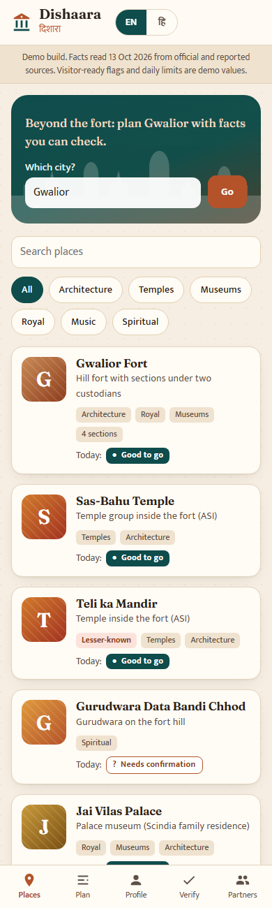
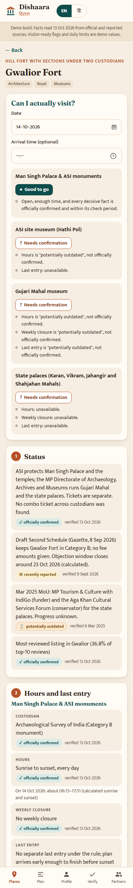
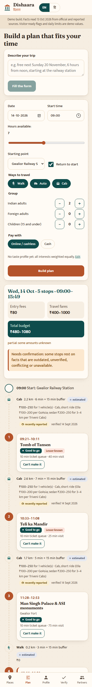
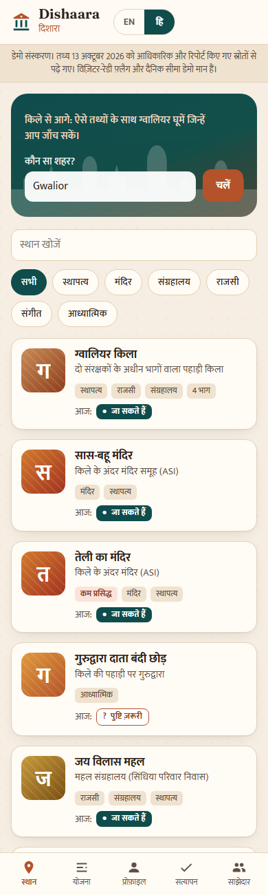
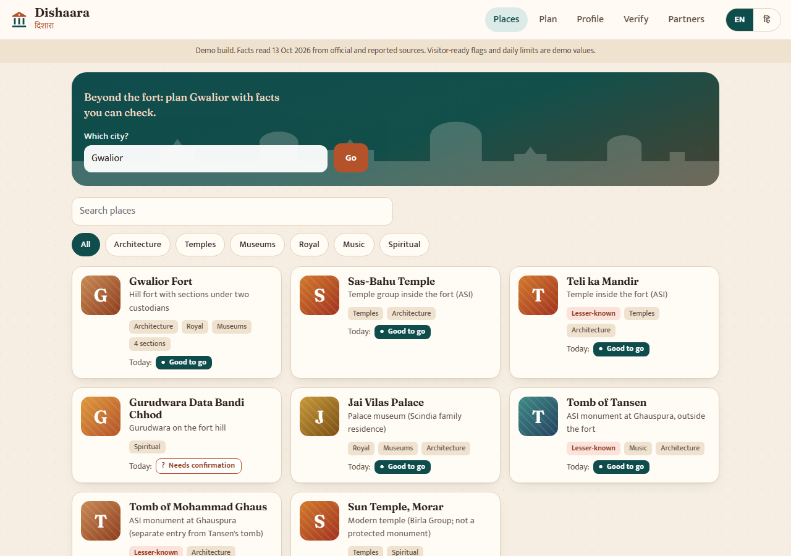
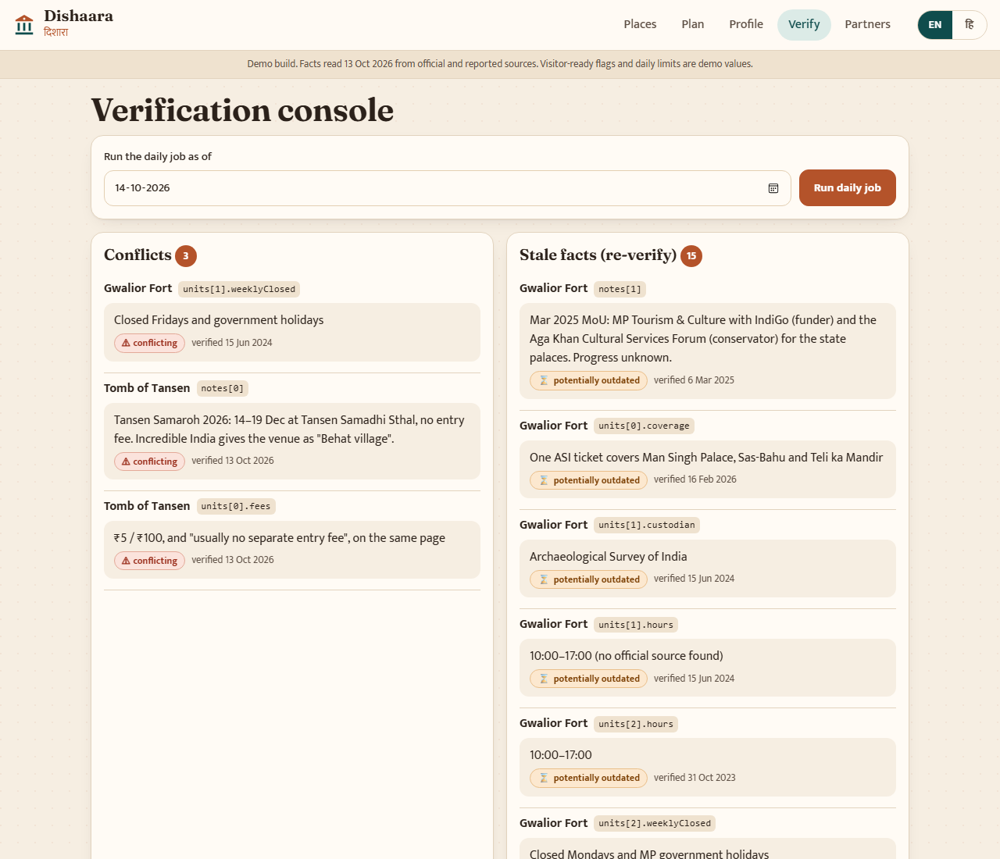
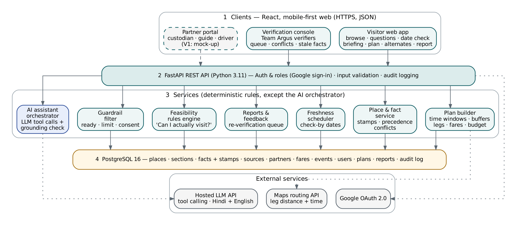

# Dishaara: beyond the fort

Team Argus · AI Synergy Hackathon 2026 · Tourism case "Beyond the Fort" · Round 1 deliverable 5 (technical feasibility proof).

**Live demo:** https://adi-ctive.github.io/Dishaara-beyond-the-fort/
**Sample plan in one click:** https://adi-ctive.github.io/Dishaara-beyond-the-fort/?sample#/plan
**Hindi:** https://adi-ctive.github.io/Dishaara-beyond-the-fort/?lang=hi#/

## Problem and solution

Visitors to heritage cities plan a fixed time budget on Google, Maps and social media. Famous sites are easy to find. What is missing, in one trusted and current place, is lesser-known places matched to interests, realistic travel time and cost between places, and current site details (hours, closures, fees by payment mode, entry rules). Official facts exist, but they are split across custodians (ASI, MP State Archaeology, trusts, the tourism board), undated and hard to find. Gwalior Fort alone has two custodians with separate tickets. Dishaara keeps one verified, dated record per place, with every fact showing its source and one of eight status labels. It answers "Can I actually visit on this date?" with explicit rules, and builds a plan that fits the visitor's hours. It only recommends places within the limits their custodians set.

## Screenshots

| Places | Fort briefing | Plan timeline | Hindi |
|---|---|---|---|
|  |  |  |  |




## Architecture



The diagram is the target V1 design from the SRS. This prototype implements it like this:

```
web/                 React 18 + Vite + TypeScript, deployed to GitHub Pages
  src/data/gwalior.json   seed: 9 places, Fort split into 4 sections, every fact stamped
  src/core/               rules that must hold, as plain deterministic TypeScript
    facts.ts              fact stamps, check-by intervals, daily freshness job
    feasibility.ts        "Can I actually visit?" verdicts (SRS §6.4)
    planner.ts            time-fit plan, buffers, budget (FR-PL)
    guardrail.ts          visitor-ready flag, consent, daily limit (FR-GR)
    alternates.ts         "Can't make it" alternates and replan (FR-AL)
    geo.ts                leg distance, time and fare, labelled estimated (E6)
    parse.ts              trip text, date/weekday check (E19), coverage (E20)
  src/pages/              Places, Briefing, Plan, Profile, Verify console, Partner portal, Ask
backend/             FastAPI: POST /ask with tool calls and a grounding check
```

The live site needs no server. The briefing, verdicts and plans all run from the seed file and the core module in the browser. This is SRS fallback E7: the product still works when the AI is down. The AI panel only appears when `VITE_API_URL` points at a running backend.

## What is real and what is mocked

| Real (working code) | Mocked or estimated |
|---|---|
| Seed facts from official and reported sources, each with source, evidence, verified date, check-by and one of the 8 labels | Google sign-in: a name field, stored only in your browser |
| Daily freshness job: past check-by becomes "potentially outdated" and joins the re-verify queue | Partner portal: custodian flag edits apply in your browser only; guide and driver forms don't submit |
| Feasibility verdicts from explicit rules, with reasons, per Fort section | Routing API: legs are straight-line distance × 1.5 at a set speed, labelled "estimated" |
| Planner: opening, latest arrival, closing, max(15 min, 20%) leg buffer, 10 min ticket buffer, total ≤ hours | Map positions of places: team estimates, labelled "estimated" |
| Budget range by visitor type and cash/online, each ticket counted once, partial when a value is unknown | Visit durations: team planning defaults, labelled "estimated" |
| Guardrail and daily limits from saved plans; unflagged places shown only on search | Visitor-ready flags and daily limits: **demo values**, marked as such in the data and UI |
| "Can't make it": up to 3 alternates that pass the guardrail, are feasible and fit the remaining time | Visitor reports and saved plans: stored in localStorage, not a database |
| Date/weekday mismatch question, "not covered yet" for other cities | LLM: `/ask` uses a deterministic writer until a provider is chosen; the tool calls and grounding check are real |
| Full Hindi/English UI | |
| Backend `/ask`: tool calls, a grounding check that blocks unknown times, fees, distances and phones, one regeneration, then a structured-only fallback | |

## Run locally

Frontend (Node 20+):

```bash
cd web && npm install && npm run dev
```

Core tests:

```bash
cd web && npm test
```

Backend (Python 3.11+):

```bash
cd backend && python -m venv .venv && .venv/Scripts/pip install -r requirements.txt
```

```bash
cd backend && .venv/Scripts/python -m uvicorn app.main:app --reload --port 8000
```

```bash
cd backend && .venv/Scripts/python -m pytest -q
```

On macOS or Linux, use `.venv/bin/` instead of `.venv/Scripts/`. To show the Ask panel, copy `web/.env.example` to `web/.env`, set `VITE_API_URL=http://localhost:8000`, and restart the dev server. No API key ever goes in the frontend. Backend settings go in `backend/.env` (see `backend/.env.example`).

## Features, SRS requirements and tests

| Feature | SRS IDs | Test |
|---|---|---|
| Plans respect hours and last entry; buffers; same input gives the same plan | FR-PL-02, PL-03, PL-08 | AT-01 `web/src/core/core.test.ts` |
| Plans fit the time budget, including the return leg | FR-PL-04 | AT-02 |
| Missing fact is not invented; answer gives the official contact | FR-AI-05, KB-03 | AT-03 `backend/tests/test_ai.py` |
| Stale fact flagged, queued, plan "needs confirmation" | FR-VF-05, PL-07 | AT-04 |
| Unflagged place never promoted, still searchable | FR-GR-02, GR-03 | AT-06 |
| Daily limit excludes a place from the third plan | FR-GR-04 | AT-07 |
| Weekly holiday → "not feasible"; ≤ 3 eligible alternates; all 4 verdicts | FR-FC-01, AL-01, AL-02 | AT-08 (web and backend) |
| Fort fees by visitor type and cash/online; separate section tickets | FR-KB-02, BR-01 | AT-09 |
| Grounding check blocks an invented time, regenerates once, falls back, logs | FR-AI-04 | AT-10 `backend/tests/test_ai.py` |
| Works without the LLM and routing API; legs marked estimated | E6, E7 | AT-13 |
| Chat-style trip text: date/weekday question, profile defaults, no disliked places, Hindi too | FR-VO-03, VO-07, AI-10, E19 | AT-16 |
| Uncovered city → "not covered yet" | FR-AI-11, E20 | AT-17 (web and backend) |
| Briefing in SRS order; every fact shows its label and date; tap for source; report a fact | FR-BR-01, BR-02, VF-07, FB-03 | UI: place page |
| Verification console: conflicts, stale facts, reports, unavailable fields | FR-AD, VF-05 | UI: Verify page |

## Data sources and labels

- Facts come from the team's data-validation report (read 13 Oct 2026). The main sources are the AMASR Rules 1959 (ASI fees and hours, G.S.R. 1171(E), 4 Dec 2018), ASI lists, NPCI, CAG Report 7 of 2022 (MP), MP Tourism pages, and jaivilaspalace.in. Third-party pages are kept as "recently reported" or lower and never override a custodian.
- Every fact has a stamp: source, source type, evidence, verified date (the evidence date, or the date read if undated), verified by, check-by, and a label. The eight labels are: officially confirmed, locally verified, recently reported, estimated, historical pattern, unverified, conflicting, potentially outdated.
- Anything not sourced is stored as **unavailable** with a reason. Dishaara never fills in hours, fees, history or accessibility. If a place has no sourced hours, the planner leaves it out and says why.
- Examples in the demo: Gujari Mahal hours from an MP Tourism page of Oct 2023 show "potentially outdated". The ASI site museum closing day (Friday vs Monday) and the Tansen tomb fee show "conflicting". Jai Vilas's 2021 state-page fee appears as an older value under the custodian's ₹350 / ₹550 / ₹1000.
- Fares are dated sample ranges from GoAsia (Jun 2026) and Triveni Cabs (Sep 2026), labelled reported. When a leg has no fare band, it shows "fare unknown" and the budget is marked partial.
- The case file's simulated numbers (67%, 5–8 h, 3–8 km) are not stored as facts.
- Privacy (DPDP Act 2023): no location history. The prototype keeps the name, preferences, saved plans and reports in the browser only.
