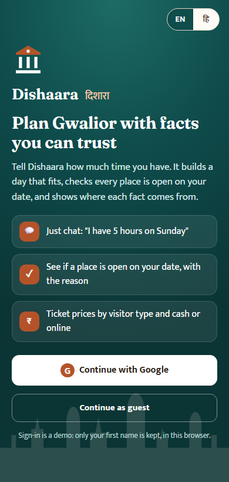
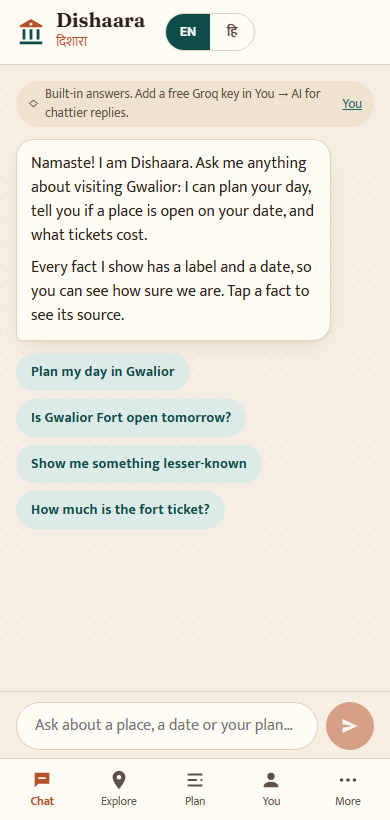
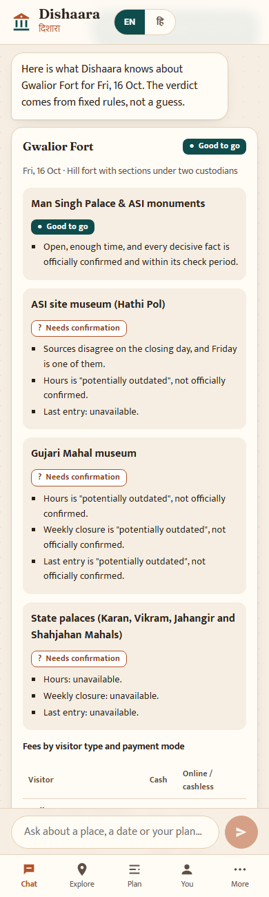
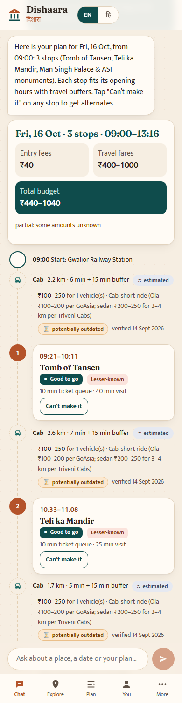
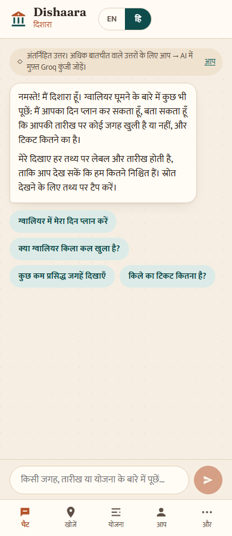

# Dishaara: beyond the fort

Team Argus · AI Synergy Hackathon 2026 · Tourism case "Beyond the Fort" · Round 1 deliverable 5 (technical feasibility proof).

**Live demo:** https://adi-ctive.github.io/Dishaara-beyond-the-fort/ (opens on the sign-in screen; "Continue as guest" works)

One-click links that skip sign-in:
- Ask a question: https://adi-ctive.github.io/Dishaara-beyond-the-fort/?ask=Is%20Gwalior%20Fort%20open%20tomorrow%3F
- Get a plan: https://adi-ctive.github.io/Dishaara-beyond-the-fort/?ask=Plan%205%20hours%20tomorrow%20starting%20at%20the%20railway%20station
- Hindi: https://adi-ctive.github.io/Dishaara-beyond-the-fort/?guest&lang=hi

## How to use it

1. Sign in (demo Google sign-in, first name only) or continue as a guest.
2. Pick what you enjoy and how you like to travel, or skip.
3. Chat. Try "Plan my day", "Is Jai Vilas open on Monday?" or "How much is the fort ticket?". Dishaara asks one simple question at a time (which day, how many hours, where you start) and answers with cards: a plan timeline, a visit verdict, or a fee table.
4. Everything else sits in tabs: **Explore** (all places and full briefings), **Plan** (the same planner as a form), **You** (profile, language, optional AI key) and **More** (verification console, partner portal, what the labels mean).

## Problem and solution

Visitors to heritage cities plan a fixed time budget on Google, Maps and social media. Famous sites are easy to find. What is missing, in one trusted and current place, is lesser-known places matched to interests, realistic travel time and cost between places, and current site details (hours, closures, fees by payment mode, entry rules). Official facts exist, but they are split across custodians (ASI, MP State Archaeology, trusts, the tourism board), undated and hard to find. Gwalior Fort alone has two custodians with separate tickets. Dishaara keeps one verified, dated record per place, with every fact showing its source and one of eight status labels. It answers "Can I actually visit on this date?" with explicit rules, and builds a plan that fits the visitor's hours. The SRS now specifies a two-level guardrail (Decision 25, 15 Oct 2026): a place may appear in plans and alternates only when its custodian's own current publication shows it open and ticketed (Level 1), and the lesser-known boost, discovery lists and daily limits need an explicit custodian flag (Level 2). **This prototype still implements the earlier single-flag guardrail (Decision 23) with demo values**; see "Guardrail: prototype vs current design" below.

## Screenshots

| Sign in | Chat home | Visit check | Plan in chat | Hindi |
|---|---|---|---|---|
|  |  |  |  |  |


## Architecture


The diagram is the target V1 design from the SRS. This prototype implements it like this:

```
web/                 React 18 + Vite + TypeScript, deployed to GitHub Pages
  src/data/gwalior.json   seed: 9 places, Fort split into 4 sections, every fact stamped
  src/core/               rules that must hold, as plain deterministic TypeScript
    facts.ts              fact stamps, check-by intervals, daily freshness job
    feasibility.ts        "Can I actually visit?" verdicts (SRS §6.4)
    planner.ts            time-fit plan, buffers, budget (FR-PL)
    guardrail.ts          single demo flag, consent, daily limit (earlier FR-GR; not yet the two-level rule)
    alternates.ts         "Can't make it" alternates and replan (FR-AL)
    geo.ts                leg distance, time and fare, labelled estimated (E6)
    parse.ts              trip text, date/weekday check (E19), coverage (E20)
    grounding.ts          blocks AI text with a time, date, fee, distance or phone not in tool results
  src/chat/               chat engine: rule-based answers, or Groq with tool calls
  src/pages/              Welcome, Setup, Chat (home), Explore, Briefing, Plan, You, More, Verify, Partners
backend/             optional FastAPI /ask with the same tools and grounding check (local only)
```

The live site needs no server. Briefings, verdicts and plans all run in the browser from the seed file and the core module.

**The chat works in two modes:**
- **Without a key (default):** a rule-based assistant reads the message, asks for any missing detail, and answers from the tools. This is SRS fallback E7.
- **With a free Groq key:** the visitor pastes it in You → AI replies. The model (`openai/gpt-oss-120b`) calls the same five tools: search_places, get_place, check_feasibility, build_plan and find_alternates. Its reply must pass the grounding check. If it fails, the reply is regenerated once, then hidden, and the cards are shown on their own. If Groq is down or slower than 15 s, the rule-based answer is used.

Some checks never reach the model: uncovered cities (E20), emergencies (E18) and date/weekday mismatches (E19). Cards are always built from tool results, never from model text. The key is stored only in that browser and sent only to Groq. GitHub Pages can't hide a key, so none is bundled into the site.

## What is real and what is mocked

| Real (working code) | Mocked or estimated |
|---|---|
| Seed facts from official and reported sources, each with source, evidence, verified date, check-by and one of the 8 labels | Google sign-in: a first-name field, stored only in your browser |
| Daily freshness job: past check-by becomes "potentially outdated" and joins the re-verify queue | Partner portal: custodian flag edits apply in your browser only; guide and driver forms don't submit |
| Feasibility verdicts from explicit rules, with reasons, per Fort section | Routing API: legs are straight-line distance × 1.5 at a set speed, labelled "estimated" |
| Planner: opening, latest arrival, closing, max(15 min, 20%) leg buffer, 10 min ticket buffer, total ≤ hours | Map positions of places: team estimates, labelled "estimated" |
| Budget range by visitor type and cash/online, each ticket counted once, partial when a value is unknown | Visit durations: team planning defaults, labelled "estimated" |
| Guardrail and daily limits from saved plans; unflagged places shown only on search | Visitor-ready flags and daily limits: **demo values**, marked as such in the data and UI; one flag, not the two-level rule (Decision 25) |
| "Can't make it": up to 3 alternates that pass the guardrail, are feasible and fit the remaining time | Visitor reports and saved plans: stored in localStorage, not a database |
| Date/weekday mismatch question, "not covered yet" for other cities | AI on the public site: off until a visitor adds their own Groq key; no shared key is bundled |
| Full Hindi/English UI | |
| Chat: slot-filling planner, place verdict and fee cards, deep links (`?ask=`) | |
| Groq AI mode: tool calls, grounding check, one regeneration, structured fallback | |

## Guardrail: prototype vs current design

The SRS and brief were updated on 15 Oct 2026 to the two-level guardrail (Decision 25, which relaxes Decision 23). The prototype has not been updated yet:

| | Current design (SRS FR-GR-01–05) | This prototype |
|---|---|---|
| Plan eligibility | Level 1: the custodian's own current publication shows the place open and ticketed; ends if that status is potentially outdated, conflicting or withdrawn | One `visitorReady` flag, set to demo values by the team |
| Boost, discovery lists, daily limits | Level 2 only: explicit custodian flag | Any flagged place |
| Never Level 1 | Active places of worship, residential or contested sites, and sites with no custodian publication showing them ticketed | Not enforced: the demo data flags the Ghaus and Tansen tombs, Gurudwara Data Bandi Chhod and the Sun Temple as visitor-ready |
| Tests | AT-06, AT-07 (rewritten) and AT-19 (new) | AT-06 and AT-07 in their earlier single-flag form; AT-19 not implemented |

## Run locally

Frontend (Node 20+):

```bash
cd web && npm install && npm run dev
```

Core tests:

```bash
cd web && npm test
```

Backend (Python 3.11+):

```bash
cd backend && python -m venv .venv && .venv/Scripts/pip install -r requirements.txt
```

```bash
cd backend && .venv/Scripts/python -m uvicorn app.main:app --reload --port 8000
```

```bash
cd backend && .venv/Scripts/python -m pytest -q
```

On macOS or Linux, use `.venv/bin/` instead of `.venv/Scripts/`.

To try AI replies, get a free key at console.groq.com and paste it in the app under You → AI replies. To run the live Groq tests locally, set `GROQ_KEY` in your shell before `npm test`. They are skipped otherwise, including in CI. Never commit a key.

## Features, SRS requirements and tests

| Feature | SRS IDs | Test |
|---|---|---|
| Plans respect hours and last entry; buffers; same input gives the same plan | FR-PL-02, PL-03, PL-08 | AT-01 `web/src/core/core.test.ts` |
| Plans fit the time budget, including the return leg | FR-PL-04 | AT-02 |
| Missing fact is not invented; answer gives the official contact | FR-AI-05, KB-03 | AT-03 `backend/tests/test_ai.py` |
| Stale fact flagged, queued, plan "needs confirmation" | FR-VF-05, PL-07 | AT-04 |
| Unflagged place never promoted, still searchable (earlier single-flag version) | FR-GR-02, GR-03 | AT-06 (earlier version) |
| Daily limit excludes a place from the third plan (earlier single-flag version) | FR-GR-04 | AT-07 (earlier version) |
| Weekly holiday → "not feasible"; ≤ 3 eligible alternates; all 4 verdicts | FR-FC-01, AL-01, AL-02 | AT-08 (web and backend) |
| Fort fees by visitor type and cash/online; separate section tickets | FR-KB-02, BR-01 | AT-09 |
| Grounding check blocks an invented time, regenerates once, falls back, logs | FR-AI-04 | AT-10 `web/src/chat/chat.test.ts` and `backend/tests/test_ai.py` |
| Chat asks one missing detail at a time, then builds the plan; works in Hindi | FR-AI-10, VO-05 | `web/src/chat/chat.test.ts` |
| Works without the LLM and routing API; legs marked estimated | E6, E7 | AT-13 |
| Chat-style trip text: date/weekday question, profile defaults, no disliked places, Hindi too | FR-VO-03, VO-07, AI-10, E19 | AT-16 |
| Uncovered city → "not covered yet" | FR-AI-11, E20 | AT-17 (web and backend) |
| Briefing in SRS order; every fact shows its label and date; tap for source; report a fact | FR-BR-01, BR-02, VF-07, FB-03 | UI: place page |
| Verification console: conflicts, stale facts, reports, unavailable fields | FR-AD, VF-05 | UI: Verify page |

## Data sources and labels

- Facts come from the team's data-validation report (read 13 Oct 2026). The main sources are the AMASR Rules 1959 (ASI fees and hours, G.S.R. 1171(E), 4 Dec 2018), ASI lists, NPCI, CAG Report 7 of 2022 (MP), MP Tourism pages, and jaivilaspalace.in. Third-party pages are kept as "recently reported" or lower and never override a custodian.
- Every fact has a stamp: source, source type, evidence, verified date (the evidence date, or the date read if undated), verified by, check-by, and a label. The eight labels are: officially confirmed, locally verified, recently reported, estimated, historical pattern, unverified, conflicting, potentially outdated.
- Anything not sourced is stored as **unavailable** with a reason. Dishaara never fills in hours, fees, history or accessibility. If a place has no sourced hours, the planner leaves it out and says why.
- Examples in the demo: Gujari Mahal hours from an MP Tourism page of Oct 2023 show "potentially outdated". The ASI site museum closing day (Friday vs Monday) and the Tansen tomb fee show "conflicting". Jai Vilas's 2021 state-page fee appears as an older value under the custodian's ₹350 / ₹550 / ₹1000.
- Fares are dated sample ranges from GoAsia (Jun 2026) and Triveni Cabs (Sep 2026), labelled reported. When a leg has no fare band, it shows "fare unknown" and the budget is marked partial.
- The case file's simulated numbers (67%, 5–8 h, 3–8 km) are not stored as facts.
- Privacy (DPDP Act 2023): no location history. The prototype keeps the name, preferences, saved plans and reports in the browser only.
